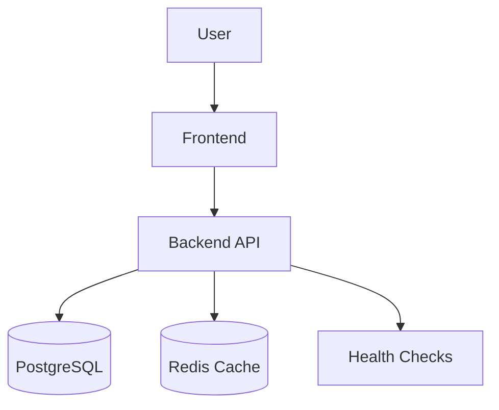

# Migrations, Docker & Polish

A production-focused continuation of the Parallax Labs Internship project, completing Week 6 requirements through database migration, Docker containerization, Redis reliability, health checks, UI polishing, and production optimization.

## Overview

This project focuses on preparing the existing multi-tenant application for reliable deployment and production use. The implementation builds on the Week 5 Redis caching and settings functionality while improving database safety, infrastructure, error handling, responsiveness, and documentation.

## Week 6 Objectives

- Safe database migration with a 100,000-row seeded dataset
- Zero-downtime migration approach
- Responsive UI improvements
- Custom 404 and 500 error handling
- Empty, loading, and error states
- Full Docker Compose setup
- PostgreSQL database container
- Redis container
- Application health and readiness checks
- Redis failure fallback
- Frontend production build optimization
- Comprehensive project documentation

## Key Features

### Database Migration

The project includes a structured migration workflow designed to minimize application downtime during schema changes.

The migration process is tested against a 100,000-row dataset to verify:

- Data integrity
- Migration reliability
- Existing record preservation
- Application compatibility
- Database performance

### Redis Caching

Redis is used for tenant-specific settings caching.

The application supports:

- Tenant-scoped cache keys
- Cache hits and misses
- Cache invalidation after updates
- Database fallback when Redis is unavailable
- Protection against cross-tenant cached data

### Health Checks

The application provides health endpoints for monitoring service availability.

Example endpoints:

```text
/api/health/live
/api/health/ready
```

The readiness check verifies the availability of required application dependencies.

## Docker Architecture

The complete application is containerized using Docker Compose.



### Docker Services

| Service | Purpose |
|---|---|
| Frontend | Web application UI |
| Backend | API and application logic |
| PostgreSQL | Persistent application data |
| Redis | Settings cache |

## Project Structure

```text
migrations, docker & polish/
├── src/
├── drizzle/
├── scripts/
├── seed-output/
├── docker-compose.yml
├── Dockerfile
├── README.md
├── package.json
└── .env.example
```

The exact structure may vary according to the existing application architecture.

## Environment Variables

Create a local `.env` file using `.env.example`.

Do not commit real passwords, API keys, tokens, or other secrets.

Example:

```env
DATABASE_URL=your_database_connection
REDIS_URL=your_redis_connection
```

## Local Development

Install dependencies:

```bash
npm install
```

Start the development application using the project's configured development script:

```bash
npm run dev
```

## Database Migration

Run the project's migration command:

```bash
npm run db:migrate
```

The migration should be tested before production deployment.

## Seed 100,000 Rows

Run the project seed script:

```bash
npm run db:seed
```

Verify the resulting row count and database integrity after seeding.

## Docker Setup

Build and start the complete stack:

```bash
docker compose up --build
```

Run the services in the background:

```bash
docker compose up -d --build
```

Stop the services:

```bash
docker compose down
```

To remove containers and associated volumes when required:

```bash
docker compose down -v
```

Use the volume-removal command carefully because it can delete local database data.

## Production Build

Create the production frontend build using the configured project command:

```bash
npm run build
```

The production build should complete successfully before deployment.

## UI Polish

The Week 6 UI improvements include:

- Responsive desktop, tablet, and mobile layouts
- Custom 404 page
- Custom 500/error handling
- Empty states
- Loading states
- Error feedback
- Improved form validation
- Clear success feedback
- Consistent spacing and visual hierarchy
- Improved accessibility and navigation

## Testing

The project should be tested for:

- Database migration integrity
- 100,000-row dataset handling
- Settings CRUD operations
- Redis caching
- Cache invalidation
- Redis failure fallback
- Tenant isolation
- Health endpoints
- Error handling
- Responsive UI
- Production build
- Docker service connectivity

Only verified test results should be reported as successful.

## Security Considerations

- Sensitive credentials are stored through environment variables.
- Real secrets must not be committed to Git.
- Tenant-specific data must remain isolated.
- Server-side validation should be applied to incoming data.
- Health endpoints should not expose sensitive information.
- Redis cache keys must remain tenant-scoped.

## Deployment Considerations

Before deployment:

1. Verify environment variables.
2. Test the migration against the seeded dataset.
3. Verify database backups and recovery procedures.
4. Build the production application.
5. Start all Docker services.
6. Verify health and readiness endpoints.
7. Test Redis fallback behavior.
8. Confirm tenant isolation.
9. Review logs for unexpected errors.

## Week 6 Acceptance Criteria

- [x] Existing Week 5 functionality preserved
- [x] Database migration implemented
- [x] 100,000-row dataset supported
- [x] Migration integrity verified
- [x] Responsive UI polished
- [x] 404 and 500 error handling implemented
- [x] Empty, loading, and error states implemented
- [x] Frontend, backend, database, and Redis containerized
- [x] Health and readiness endpoints implemented
- [x] Redis database fallback maintained
- [x] Production frontend build verified
- [x] README documentation completed

> Update the checklist only after each item has actually been tested and verified.

## Conclusion

Week 6 completes the production-readiness phase of the Parallax Labs Internship project by combining database migration safety, Docker infrastructure, Redis reliability, health monitoring, responsive UI improvements, error handling, and production optimization into the existing application.
